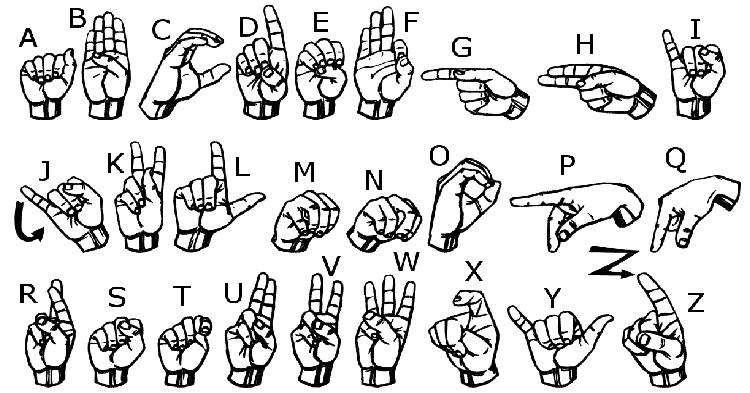

# Real-Time Sign Language Translator

An intelligent Computer Vision and Machine Learning application that detects and translates hand gestures / American Sign Language (ASL) in real-time using a webcam, converting gestures into readable text and synthesized speech.

---

## 📌 Features

- **Real-Time Hand Landmark Detection:** Employs Google MediaPipe to track 21 3D hand landmarks with high precision and low latency.
- **Machine Learning Classification:** Utilizes a trained Random Forest model to classify normalized hand landmark coordinates into alphanumeric characters and words.
- **Interactive Web Interface:** Built with Flask and SocketIO for real-time video streaming, live prediction overlay, and text-to-speech feedback.
- **Offline & Desktop Inference:** Includes standalone OpenCV scripts (`inference_classifier.py`) for local desktop testing.
- **End-to-End ML Pipeline:** Complete scripts for custom dataset collection, landmark feature extraction, model training, and performance evaluation.

---

## 🖼️ Sign Language Reference

<p align="center">
  
  <br>
  <em>American Sign Language (ASL) Alphabet Convention</em>
</p>

<p align="center">
  
  <br>
  <em>Common Hand Gesture Reference</em>
</p>

---

## 📂 Project Structure

```text
├── app.py                                         # Flask web server with SocketIO for real-time translation
├── templates/
│   └── index.html                                 # Web interface UI
├── inference_classifier.py                        # Standalone real-time desktop webcam classifier
├── collect_imgs.py                                # Script to capture custom gesture images via webcam
├── create_dataset.py                              # Extracts MediaPipe landmark coordinates into data.pickle
├── train_classifier.py                            # Trains the Random Forest classifier and outputs model.p
├── hand_landmarker.task                           # MediaPipe Hand Landmarker model task
├── model.p                                        # Serialized trained classifier model
├── data.pickle                                    # Serialized dataset landmarks & labels
├── Sign2Text_Colab.ipynb                          # Google Colab notebook for training / experimentation
├── SignLanguage_Translator_Model_Evaluation.ipynb # Model evaluation and metrics analysis
├── requirements.txt                               # Project dependencies
└── LICENSE                                        # Project License
```

---

## 🚀 Getting Started

### Prerequisites

- **Python 3.8 - 3.11**
- A connected **Webcam**

### Installation

1. **Clone the repository:**
   ```bash
   git clone <YOUR-REPOSITORY-URL>
   cd "Sign language translator"
   ```

2. **Create and activate a virtual environment:**
   - **Windows:**
     ```powershell
     python -m venv venv
     .\venv\Scripts\Activate
     ```
   - **macOS / Linux:**
     ```bash
     python3 -m venv venv
     source venv/bin/activate
     ```

3. **Install dependencies:**
   ```bash
   pip install -r requirements.txt
   ```

---

## 💻 Usage

### 1. Launch the Web Application
Run the Flask server:
```bash
python app.py
```
Open your browser and navigate to:
```
http://127.0.0.1:5000/
```
The application will activate your webcam feed, track your hand landmarks, predict the sign gesture in real-time, and convert it to text and speech.

### 2. Run Standalone Desktop Inference
To run direct OpenCV window inference without the web browser:
```bash
python inference_classifier.py
```
Press `q` to exit the video stream.

---

## 🧠 Training Your Own Custom Gestures

If you want to train the model on new signs or custom datasets:

1. **Collect Images:**
   ```bash
   python collect_imgs.py
   ```
2. **Extract Landmark Features:**
   ```bash
   python create_dataset.py
   ```
3. **Train the Classifier:**
   ```bash
   python train_classifier.py
   ```
   This generates an updated `model.p` file ready for inference.

---

## 📄 License

This project is licensed under the [MIT License](LICENSE).
